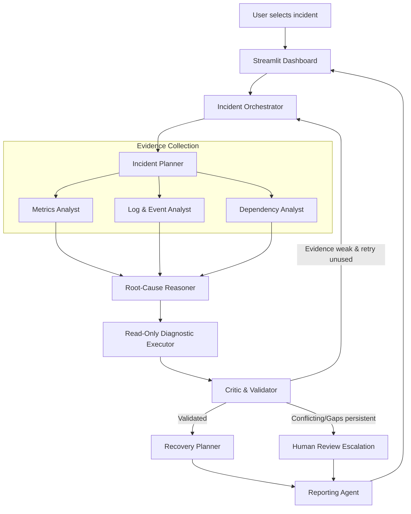

# InfraPilot AI — Multi-Agent Cloud Failure Investigator

[](https://www.python.org/downloads/)
[](https://streamlit.io/)
[](https://docs.pytest.org/)
[]()

> **Turn scattered cloud telemetry into a traceable incident hypothesis and a human-reviewed recovery plan.**

---

## 1. Executive Summary & Problem Statement

Cloud microservice architectures contain deeply interconnected services. When a database becomes saturated, upstream order APIs queue requests, latencies spike, error cascades propagate to frontend users, and alerts fire simultaneously across observability dashboards. Engineers are tasked with sifting through disjointed metrics, distributed logs, deployment histories, and service topologies under intense time pressure.

**InfraPilot AI** coordinates a specialized team of autonomous AI agents to investigate simulated cloud incidents. Rather than relying on a single conversational chatbot guessing from context, InfraPilot AI establishes a structured agentic workflow:
- **Autonomous Agents with Distinct Responsibilities:** Planning, metrics, logs, dependencies, reasoning, diagnostics, critic validation, recovery planning, and audit reporting.
- **Real Local Telemetry Tools:** Real pure Python tools executing baseline statistical comparison, regex pattern scanning, NetworkX topological analysis, and read-only diagnostic tests.
- **Verifiable Evidence Grounding:** Hypotheses must cite stable evidence IDs (`METRIC-...`, `LOG-...`, `DEP-...`, `DIAG-...`).
- **Bounded Retry Discipline & Escalation:** Max 1 targeted re-investigation retry; uncertain or conflicting incidents escalate to `Needs Human Review`.
- **Absolute Read-Only Safety:** Strict policy blocking destructive actions; all outputs flagged `RECOMMENDATION_ONLY` with mandatory human sign-off.

---

## 2. Architecture & Multi-Agent Flow



---

## 3. Specialized Agent Roles

| Agent | Responsibility | Real Local Tools Called | Structured Output |
|---|---|---|---|
| **1. Incident Planner** | Deconstructs incident summary into investigation questions & scopes target services | `plan_inquiry_scope` | `IncidentPlan` |
| **2. Metrics Analyst** | Scans metrics, compares against baseline, determines earliest anomaly onset, detects telemetry dropouts | `rank_anomalies`, `find_first_anomaly`, `compare_to_baseline` | `List[MetricFinding]`, `METRIC-...` Evidence |
| **3. Log & Event Analyst** | Scans error patterns, inspects deployment/alert events, sanitizes untrusted log text | `count_log_patterns`, `get_recent_events`, `search_logs` | `List[LogFinding]`, `LOG-...`, `EVENT-...` Evidence |
| **4. Dependency Analyst** | Builds directed graph (Caller → Upstream), traces topological call paths, validates blast radius | `build_dependency_graph`, `get_upstream_services`, `get_downstream_impact`, `check_path_exists` | `List[DependencyFinding]`, `DEP-...` Evidence |
| **5. Root-Cause Reasoner** | Computes multi-source transparent heuristic scores and ranks candidate root causes with limitations | `identify_candidate_services`, `rank_hypotheses` | `List[Hypothesis]` |
| **6. Diagnostic Executor** | Runs safe, non-destructive checks against leading hypothesis (timeline precedence, viability) | `compare_metric_timelines`, `verify_dependency_viability`, `compare_event_window_impact`, `verify_log_error_correlation` | `List[DiagnosticResult]`, `DIAG-...` Evidence |
| **7. Critic & Validator** | Audits evidence grounding, validates cited IDs against store, flags gaps, controls retry budget | `verify_evidence_ids`, `render_validation_decision` | `ValidationResult` (`PASS`, `REINVESTIGATE`, `HUMAN_REVIEW`) |
| **8. Recovery Planner** | Formulates safe, reversible, prioritized remediation steps and post-verification checks | `formulate_remediation_steps`, `validate_all_recommendations` | `List[RecoveryRecommendation]` |
| **9. Reporting Agent** | Compiles complete audit trail into downloadable Markdown and JSON incident reports | `export_reports` | `IncidentReport` (`.md`, `.json`) |

---

## 4. Transparent Heuristic Scoring Formula

Rather than treating confidence as a black box, InfraPilot AI calculates an explainable heuristic score:

$$\text{Candidate Score} = 0.30 \times S_{\text{metric}} + 0.25 \times S_{\text{log}} + 0.25 \times S_{\text{dependency}} + 0.20 \times S_{\text{timeline}} - P_{\text{contradiction}}$$

- **$S_{\text{metric}}$:** Normalized degree of metric breach over baseline (p95 latency, error rate, CPU, connection saturation).
- **$S_{\text{log}}$:** Matching error patterns and correlated operational lifecycle events.
- **$S_{\text{dependency}}$:** Topological verification that candidate is an upstream dependency of the symptom service.
- **$S_{\text{timeline}}$:** 1.0 if candidate anomaly onset strictly preceded downstream symptoms; 0.2 if lagged.
- **$P_{\text{contradiction}}$:** 0.35 penalty applied if telemetry is missing, truncated, or contradictory.

---

## 5. Synthetic Scenarios Included

1. **Scenario A (`INC-1001`) — Database Latency Spike & Connection Saturation (Main Demo)**
   - *Symptoms:* Order API p95 latency > 2000ms, HTTP 504 Gateway Timeouts.
   - *Root Cause:* Database connection pool exhaustion and query latency spike at 10:16 strictly preceding Order API degradation at 10:18.
   - *Distractor:* Minor Payment Service memory variance at 10:22.
   - *Result:* `Validated hypothesis` (`database`).

2. **Scenario B (`INC-1002`) — Deployment-Induced Order API Regression**
   - *Symptoms:* Order API 500 Internal Server Errors jump to 28% on checkout endpoint.
   - *Root Cause:* Release v2.4.1 deployment introduced NullPointerException in discount validation. Database and cache metrics remain normal.
   - *Distractor:* Slight cache hit fluctuation during warming.
   - *Result:* `Validated hypothesis` (`order_api`).

3. **Scenario C (`INC-1003`) — Cache Degradation & Stampede**
   - *Symptoms:* Order API and Database latencies climbing following memory policy update.
   - *Root Cause:* Cache hit rate drops from 94% to 22%, causing a cache stampede of read queries that saturates database CPU.
   - *Distractor:* Periodic inventory background sync notice.
   - *Result:* `Validated hypothesis` (`cache`).

4. **Scenario D (`INC-1004`) — Inconclusive Signals & Telemetry Dropout**
   - *Symptoms:* Intermittent 503s on frontend, but upstream telemetry agent dropped out and payment logs conflict.
   - *Critic Action:* Retries once; finding persistent gaps, rejects automated conclusion and escalates to `Needs Human Review`.
   - *Result:* `Needs human review`.

---

## 6. Getting Started & Running Locally

### Prerequisites
- Python 3.11+
- No cloud credentials or paid API keys required!

### Setup
```bash
# 1. Clone or navigate to the workspace
cd "c:\Users\Admin\.gemini\antigravity-ide\scratch\InfraPilot Al"

# 2. Install dependencies
pip install -r requirements.txt

# 3. (Optional) Run automated test suite
python -m pytest tests/ -v

# 4. Launch Streamlit Application
python -m streamlit run app.py
# or (if Scripts is in PATH): streamlit run app.py
```

---

## 7. Automated Test Suite Results

```text
============================= test session starts =============================
platform win32 -- Python 3.14.6, pytest-9.1.1
rootdir: C:\Users\Admin\.gemini\antigravity-ide\scratch\InfraPilot Al

tests/test_orchestrator.py::test_scenario_a_database_spike PASSED        [  4%]
tests/test_orchestrator.py::test_scenario_b_deployment_regression PASSED [  9%]
tests/test_orchestrator.py::test_scenario_c_cache_stampede PASSED        [ 13%]
tests/test_orchestrator.py::test_scenario_d_escalates_to_human_review PASSED [ 18%]
tests/test_orchestrator.py::test_retry_count_strictly_bounded PASSED     [ 22%]
tests/test_safety.py::test_destructive_commands_blocked PASSED           [ 27%]
tests/test_safety.py::test_safe_read_only_actions_allowed PASSED         [ 31%]
tests/test_safety.py::test_log_content_sanitization PASSED               [ 36%]
tests/test_safety.py::test_recommendation_safety_enforcement PASSED      [ 40%]
tests/test_scenario_data.py::test_scenarios_load_successfully PASSED     [ 45%]
tests/test_scenario_data.py::test_services_data_integrity PASSED         [ 50%]
tests/test_scenario_data.py::test_metrics_telemetry_integrity PASSED     [ 54%]
tests/test_scenario_data.py::test_logs_telemetry_integrity PASSED        [ 59%]
tests/test_scenario_data.py::test_events_telemetry_integrity PASSED      [ 63%]
tests/test_telemetry_tools.py::test_metrics_anomaly_detection PASSED     [ 68%]
tests/test_telemetry_tools.py::test_metrics_earliest_anomaly PASSED      [ 72%]
tests/test_telemetry_tools.py::test_log_search_and_patterns PASSED       [ 77%]
tests/test_telemetry_tools.py::test_dependency_topology PASSED           [ 81%]
tests/test_telemetry_tools.py::test_read_only_diagnostics PASSED         [ 86%]
tests/test_validation.py::test_critic_rejects_unregistered_evidence_ids PASSED [ 90%]
tests/test_validation.py::test_critic_reinvestigate_on_first_try PASSED  [ 95%]
tests/test_validation.py::test_critic_escalates_to_human_review_after_retry PASSED [100%]

============================= 22 passed in 9.74s ==============================
```

---

## 8. Safety Guarantees & Human-in-the-Loop Controls

1. **Strict Read-Only Diagnostics:** Telemetry queries calculate statistical aggregations and timeline delta comparisons. No shell execution, service restarts, or mutating cloud API calls exist in the codebase.
2. **Untrusted Log Data Sanitization:** Logs are treated strictly as passive text evidence. The safety layer (`infrapilot/safety/policy.py`) sanitizes prompt injection attempts and dangerous command tokens (`DROP TABLE`, `rm -rf`, `ignore instructions`).
3. **Non-Executing Advisory Actions:** All recovery proposals are tagged `RECOMMENDATION_ONLY` with explicit risk levels (`LOW`, `MEDIUM`, `HIGH`) and verification steps. Human engineering sign-off is mandatory before any action is executed.

---

## 9. Five-Minute Live Demo Script

- **0:00 - 0:30 (Problem Statement):** Explain the challenge of diagnosing distributed cloud failures across disconnected logs, metrics, and call graphs.
- **0:30 - 1:00 (Solution Architecture):** Introduce InfraPilot AI's multi-agent workflow, real local tools, and evidence grounding.
- **1:00 - 1:45 (Inject Incident):** Select `INC-1001` (Database Latency Spike) in the sidebar. Show Tab 1 latency and error rate spikes. Point out the vertical incident onset marker.
- **1:45 - 2:45 (Agent Activity Trace):** Click **"Run Multi-Agent Investigation"**. Switch to Tab 2 to demonstrate actual tools called by each of the 8 agents in real time.
- **2:45 - 3:45 (Root Cause & Service Topology):** Switch to Tab 3. Highlight the ranked hypotheses, heuristic evidence score breakdown, interactive NetworkX topology map (culprit highlighted in purple), and Critic verdict.
- **3:45 - 4:30 (Recovery Plan & Report Export):** Switch to Tab 4. Review prioritized, reversible remediation steps. Download the audit-ready `.md` and `.json` report.
- **4:30 - 5:00 (Scenario D Edge Case & Q&A):** Select `INC-1004` (Inconclusive Signals) and run investigation to show Critic escalating to `Needs Human Review` after bounded retry.

---

## 10. Key Viva / Technical Questions

**Q1: Why is InfraPilot AI an agentic system and not a chatbot?**  
*A:* It features autonomous specialized agents with distinct roles, deterministic local tools, a shared typed state, conditional routing, diagnostic verification, a strictly bounded retry loop (max 1), and human review escalation.

**Q2: How is hallucination prevented in root-cause determination?**  
*A:* Hypotheses are grounded in registered evidence IDs (`METRIC-...`, `LOG-...`, `DEP-...`). The Critic Validator rejects any claim that cites unverified or missing evidence IDs.

**Q3: How are confidence scores calculated?**  
*A:* Using a transparent heuristic evidence aggregation formula combining metric deviation, log error frequency, dependency path viability, and timeline onset precedence—not uncalibrated black-box probabilities.
