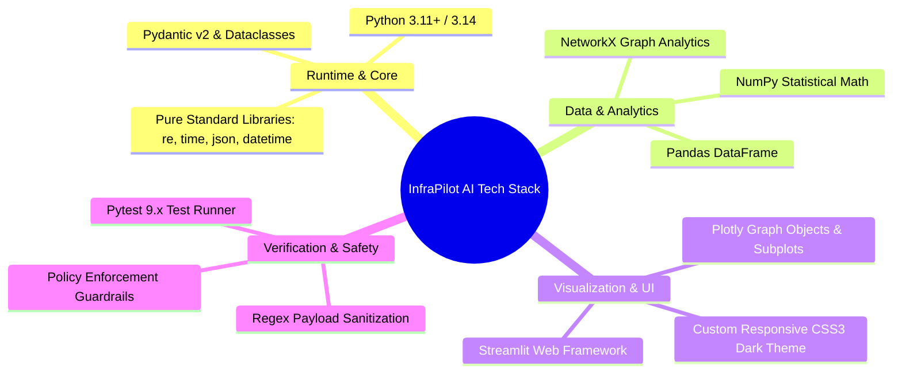
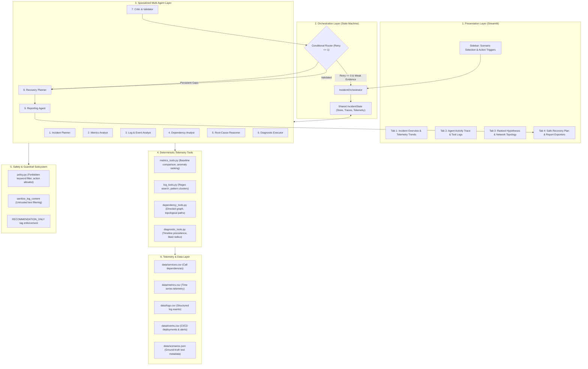
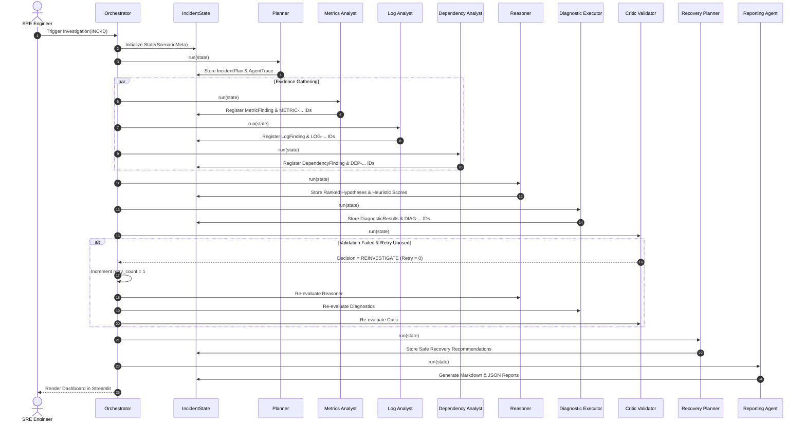
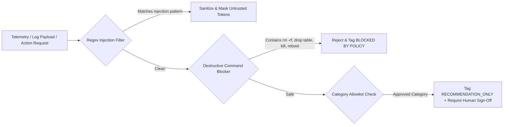
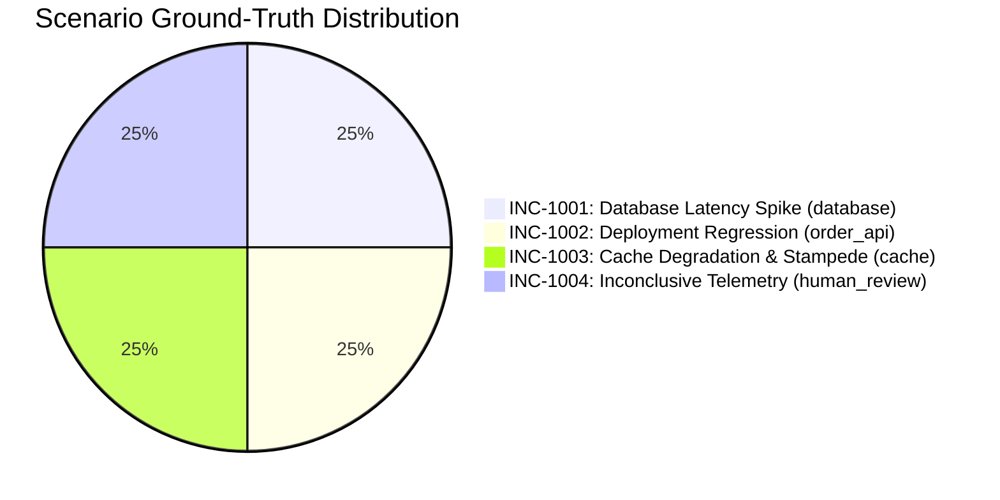

# InfraPilot AI — Comprehensive Technical Architecture, Pipeline & Engineering Manual

---

## 1. Project Overview & System Philosophy

**InfraPilot AI** is a multi-agent Site Reliability Engineering (SRE) and cloud failure investigation platform. Modern cloud-native microservices fail across complex, multi-tiered dependency chains. When an upstream dependency (such as an operational database or distributed cache) experiences degradation, cascading errors propagate downstream to customer-facing APIs and frontends. Engineers are overwhelmed by high-cardinality metrics, fragmented log streams, continuous deployment pipelines, and interdependent topological call graphs.

### Core Architectural Shift
Traditional AI approaches in incident response rely on a **single generative chatbot** attempting to guess the failure cause from an arbitrary prompt. This leads to hallucinations, lack of evidence grounding, unpredictable action execution, and zero safety guarantees.

**InfraPilot AI replaces the single chatbot with an orchestrated multi-agent state machine:**
1. **Specialized Agents:** Distinct computational agents with single, verifiable responsibilities.
2. **Deterministic Tooling:** Agents call real, local telemetry analytics functions rather than speculating.
3. **Evidence Grounding:** Every hypothesis must cite verifiable, immutable evidence identifiers (`METRIC-...`, `LOG-...`, `DEP-...`, `DIAG-...`).
4. **Bounded Retry Discipline:** A strict maximum of **one targeted re-investigation** retry prevents infinite loops and computational waste.
5. **Deterministic Escalation:** Ambiguous or contradictory signals escalate immediately to `Needs Human Review`.
6. **Strict Read-Only Safety:** Code-level policies guarantee that no mutating cloud APIs or destructive system commands can ever be executed.

---

## 2. Technology Stack & Component Specifications

The entire platform is built with a zero-cost, laptop-friendly, zero-API-key architecture. Every computation runs locally, deterministically, and reproducibly.



### Detailed Component Inventory

| Layer | Technology | Version | Purpose & Rationale |
|---|---|---|---|
| **Language & Runtime** | Python | `3.11+` | Primary language; rich ecosystem for data engineering and deterministic agent workflows. |
| **Interactive UI** | Streamlit | `>=1.30.0` | High-performance interactive dashboard; provides stateful tab navigation, reactive re-rendering, and instant parameter injection. |
| **Data Manipulation** | Pandas | `>=2.0.0` | In-memory indexing, slicing, baseline-window filtering, and time-series aggregation of synthetic telemetry. |
| **Statistical Computing** | NumPy | `>=1.26.0` | Gaussian noise generation, baseline deviation calculations, and threshold normalization. |
| **Graph Analytics** | NetworkX | `>=3.0` | Directed topological modeling ($V, E$) of microservice call graphs; ancestor/descendant reachability and shortest-path failure analysis. |
| **Interactive Visuals** | Plotly | `>=5.18.0` | Interactive hardware-accelerated time-series plots, dual-axis incident charts, radar breakdowns, and directed network maps. |
| **Type Integrity & State** | Dataclasses / Pydantic | `>=2.0.0` | Strict typed schemas for evidence records, agent traces, hypotheses, diagnostic results, and incident state. |
| **Automated Testing** | Pytest | `>=8.0.0` | Comprehensive regression suite covering data integrity, telemetry tools, orchestrator control flow, critic logic, and safety guardrails. |
| **Safety & Sanitization** | Custom Regex Engine | Native | Pattern-matching engine that screens for command injection, forbidden shell verbs, and sanitizes untrusted log payloads. |

---

## 3. End-to-End System Architecture

InfraPilot AI is structured into six decoupled architectural layers:



---

## 4. Multi-Agent Pipeline & Specialized Roles

The platform deploys **nine specialized agents**, each operating as an autonomous class with defined inputs, deterministic tool executions, and typed outputs registered directly to the shared `IncidentState`.

### Agent Specification Matrix



### Detailed Agent Responsibilities

#### 1. Incident Planner (`planner.py`)
- **Role:** Deconstructs the incident symptom statement into an investigation checklist.
- **Inputs:** `state.scenario_info` (Incident summary, reported affected services, severity).
- **Tools Called:** `plan_inquiry_scope(affected_services, severity)`.
- **Output:** `IncidentPlan` outlining target candidate services, 5 specific investigation inquiries, and assigned data sources.

#### 2. Metrics Analyst (`metrics_analyst.py`)
- **Role:** Analyzes statistical divergence across time-series metrics relative to baseline windows.
- **Inputs:** `state.scenario_info.baseline_window`, `state.scenario_info.incident_window`.
- **Tools Called:** 
  - `rank_anomalies()`: Scans all metric series and computes anomaly severity scores.
  - `find_first_anomaly()`: Pinpoints the earliest service/metric breach chronologically.
  - `get_metric_series()`: Detects telemetry dropouts or truncation during incident windows.
- **Output:** `List[MetricFinding]`, registers immutable `METRIC-...` records into `state.evidence_store`.

#### 3. Log & Event Analyst (`log_analyst.py`)
- **Role:** Correlates structured application log clusters and lifecycle events while treating logs as untrusted data.
- **Inputs:** `logs.csv`, `events.csv`, time windows.
- **Tools Called:**
  - `get_recent_events()`: Retreives CI/CD deployments, configuration changes, and alert thresholds.
  - `count_log_patterns()`: Scans for regex clusters (timeouts, 5xx errors, exceptions, evictions).
- **Safety Feature:** Calls `sanitize_log_content()` to scrub potential prompt injection or destructive command strings found inside raw log payloads.
- **Output:** `List[LogFinding]`, `List[EventFinding]`, registers `LOG-...` and `EVENT-...` evidence IDs.

#### 4. Dependency Analyst (`dependency_analyst.py`)
- **Role:** Analyzes topological call graphs to verify if candidate services can physically cause downstream symptoms.
- **Inputs:** `services.csv`, `state.scenario_info.affected_services`.
- **Tools Called:**
  - `build_dependency_graph()`: Constructs a directed graph $G = (V, E)$ where edges represent $Caller \rightarrow Upstream$.
  - `get_upstream_services()`: Finds all transitive dependencies of symptom endpoints.
  - `get_downstream_impact()`: Determines blast radius if a given service fails.
  - `check_path_exists()`: Calculates topological shortest path between candidate and symptom endpoints.
- **Output:** `List[DependencyFinding]`, registers `DEP-...` evidence records.

#### 5. Root-Cause Reasoner (`root_cause_reasoner.py`)
- **Role:** Synthesizes multi-source evidence into ranked root-cause hypotheses with explicit confidence scores and limitations.
- **Inputs:** Metric findings, log findings, event findings, dependency paths, and evidence store.
- **Tools Called:** `identify_candidate_services()`, `rank_hypotheses()`.
- **Logic:** Executes the transparent mathematical scoring formula, balances supporting versus contradicting evidence, and attaches clear caveats (e.g., *"Supported, not proven"*).
- **Output:** `List[Hypothesis]` ranked by aggregate score.

#### 6. Diagnostic Executor (`diagnostic_executor.py`)
- **Role:** Executes targeted, strictly read-only diagnostics to stress-test the top hypothesis.
- **Inputs:** Leading hypothesis, metric data, log data, services data.
- **Tools Called:**
  - `verify_dependency_viability()`: Confirms candidate is topologically upstream of all symptom services.
  - `compare_metric_timelines()`: Confirms candidate anomaly strictly preceded downstream symptom onset.
  - `compare_event_window_impact()`: Evaluates pre/post metric surge surrounding a deployment.
  - `verify_log_error_correlation()`: Verifies that error logs match the incident window.
- **Output:** `List[DiagnosticResult]`, registers `DIAG-...` evidence IDs.

#### 7. Critic & Validator (`critic.py`)
- **Role:** Audits hypothesis grounding, checks evidence validity, catches ungrounded claims, and enforces retry boundaries.
- **Checks Performed:**
  - *Evidence Verification:* Confirms that every cited evidence ID exists in `state.evidence_store`.
  - *Telemetry Gap Check:* Screens for `METRIC-GAP-...` or contradictory records.
  - *Diagnostic Pass Rate:* Audits whether read-only tests passed.
  - *Confidence Thresholding:* Compares score against pass ($0.65$) and review ($0.60$) thresholds.
- **Decisions Rendered:**
  - `PASS`: Grounded evidence, passed diagnostics, confidence $\ge 0.65$.
  - `REINVESTIGATE`: Low confidence or telemetry gaps, but `retry_count == 0`.
  - `HUMAN_REVIEW`: Gaps persist after retry, conflicting signals, or unsupported claims.
- **Output:** `ValidationResult`.

#### 8. Recovery Planner (`recovery_planner.py`)
- **Role:** Formulates safe, reversible, prioritized remediation procedures and post-verification checks.
- **Safety Constraints:**
  - Every action is strictly advisory (`RECOMMENDATION_ONLY`).
  - No active execution or mutating cloud commands permitted.
  - Requires explicit engineering sign-off.
  - Validates all recommendations against allowlisted categories.
- **Output:** `List[RecoveryRecommendation]`.

#### 9. Reporting Agent (`reporting.py`)
- **Role:** Compiles the complete investigation trace into formal, audit-ready reports.
- **Output:** Generates `INC-xxxx_investigation_report.md` and `INC-xxxx_investigation_report.json` saved directly to `reports/`.

---

## 5. Mathematical Scoring & Heuristic Confidence Engine

Confidence scores in InfraPilot AI are not arbitrary black-box LLM estimations. They are computed via a **transparent, normalized evidence-aggregation formula**:

$$\text{Confidence Score} = \Big( w_m \cdot S_{\text{metric}} + w_l \cdot S_{\text{log}} + w_d \cdot S_{\text{dependency}} + w_t \cdot S_{\text{timeline}} \Big) - P_{\text{contradiction}}$$

### Parameter Configuration

| Component | Weight | Mathematical Definition & Source |
|---|---|---|
| **$w_m$ (Metric Support)** | **$0.30$** | Degree of statistical divergence from baseline: $\min(1.0, 0.4 + (\frac{\mu_{\text{incident}}}{\mu_{\text{baseline}}} - 1) \times 0.1)$. |
| **$w_l$ (Log & Event Support)** | **$0.25$** | Log error frequency + operational event coincidence ($0.4$ base $+ 0.4$ errors $+ 0.2$ deployment event). |
| **$w_d$ (Dependency Support)** | **$0.25$** | Directed graph reachability: $0.95$ if upstream with valid caller path; $0.70$ if direct symptom endpoint; $0.15$ if disconnected. |
| **$w_t$ (Timeline Precedence)** | **$0.20$** | Temporal precedence: $1.0$ if $T_{\text{candidate}} < T_{\text{symptom}}$; $0.75$ if synchronized; $0.20$ if candidate lagged behind symptoms. |
| **$P_{\text{contradiction}}$ (Penalty)** | **$-0.35$** | Applied if telemetry dropout (`METRIC-GAP`) is detected or contradictory signals exist. |

The resulting score is clamped to $[0.05, 0.99]$ and presented as a **Heuristic Evidence Score** with full sub-score transparency.

---

## 6. Safety & Guardrail Subsystem

The safety layer (`infrapilot/safety/policy.py`) implements defense-in-depth to guarantee safe operation:



### Safety Rules Enforced in Code
1. **Zero Mutating Execution:** The application does not import cloud SDKs (boto3, azure-mgmt, google-cloud) or OS command executors (`subprocess`, `os.system`).
2. **Untrusted Log Ingestion:** Log messages are treated strictly as passive data. The `sanitize_log_content()` function screens for prompt injections (e.g., *"Ignore all previous instructions"*), SQL injection (`DROP TABLE`), and shell scripts (`rm -rf /`).
3. **Action Allowlist:** Recommendations must belong to approved read-only or verification categories:
   - `QUERY_INVESTIGATION`
   - `CONNECTION_POOL_TUNING`
   - `DEPLOYMENT_ROLLBACK_VERIFICATION`
   - `CACHE_POLICY_REVIEW`
   - `CONFIGURATION_AUDIT`
   - `DOWNSTREAM_MONITORING`
4. **Mandatory Human Sign-off:** Every recommendation object hard-codes `requires_human_approval = True` and `status = "RECOMMENDATION_ONLY"`.

---

## 7. Synthetic Data Pipeline & Incident Scenarios

The synthetic telemetry dataset (`data/generate_telemetry.py`) contains **1,245 metric time-series data points**, **80 log records**, and **10 operational events** modeling a production-grade e-commerce application:

```text
User  ──►  Frontend  ──►  Order API  ──►  Database (PostgreSQL)
                              │
                              ├──►  Cache (Redis)
                              ├──►  Payment Service
                              └──►  Inventory Service
```

### Scenario Test Matrix



| Incident ID | Title | Severity | Root Cause | Key Signals | Expected Critic Outcome |
|---|---|---|---|---|---|
| **INC-1001** | Database Latency Spike & Pool Exhaustion | `CRITICAL` | `database` | Connections jump to 94%; DB p95 latency spikes to 1250ms at 10:16; Order API spikes at 10:18. Distractor: Payment memory blip. | `PASS` (`Validated hypothesis`) |
| **INC-1002** | Deployment-Induced API Regression | `HIGH` | `order_api` | Deployment v2.4.1 event at 14:12; Order API 500 error rate surges to 28.5% at 14:13; DB & cache stay healthy. | `PASS` (`Validated hypothesis`) |
| **INC-1003** | Cache Degradation & Stampede | `HIGH` | `cache` | Cache hit rate drops from 94% to 22% at 09:14; DB CPU surges to 88% and latency rises to 480ms at 09:16. | `PASS` (`Validated hypothesis`) |
| **INC-1004** | Inconclusive Signal & Telemetry Dropout | `MEDIUM` | `human_review` | Sporadic frontend 503s; Database telemetry agent drops out at 16:12; Payment logs report conflicting network errors. | `HUMAN_REVIEW` (`Needs human review`) |

---

## 8. Interactive Dashboard Architecture (`app.py`)

The user interface is designed with a sleek SRE dark theme (`#090d16` to `#0f172a`), responsive typography, glassmorphism card containers, and persistent session state.

```text
┌────────────────────────────────────────────────────────────────────────────────────────┐
│  ⚡ InfraPilot AI — Incident Response Console                                          │
├───────────────────────┬────────────────────────────────────────────────────────────────┤
│  SIDEBAR              │  TAB 1: INCIDENT OVERVIEW                                      │
│  ───────────────────  │  - Severity & Service Tags                                     │
│  - Scenario Selector  │  - Interactive Plotly p95 Latency & Error Rate Charts          │
│  - Incident Summary   │  - CPU & Database Connection Utilization                       │
│  - [⚡ Inject Incident]│  - Operational Lifecycle Events Log                            │
│  - [🔍 Run Pipeline]  ├────────────────────────────────────────────────────────────────┤
│  - [🔄 Reset Demo]    │  TAB 2: AGENT ACTIVITY TRACE                                   │
│  - Status Indicator   │  - 9 Expandable Agent Cards with Runtime Timestamps            │
│  - Safety Guardrail   │  - Actual Tool Names, Real Inputs, and Outputs                 │
│    Notice             │  - Clickable Evidence ID Badges                                │
│                       ├────────────────────────────────────────────────────────────────┤
│                       │  TAB 3: ROOT CAUSE & TOPOLOGY                                  │
│                       │  - Ranked Hypotheses Cards (Score, Reasoning, Evidence)        │
│                       │  - Radar / Bar Heuristic Score Breakdown                       │
│                       │  - Interactive NetworkX Service Topology Map (Status Colored)  │
│                       │  - Critic Validation Decision & Diagnostics Checklist          │
│                       ├────────────────────────────────────────────────────────────────┤
│                       │  TAB 4: RECOVERY & REPORT EXPORT                               │
│                       │  - Prioritized Reversible Procedure with Risk Badges           │
│                       │  - Post-Remediation Verification Criteria                      │
│                       │  - [📥 Download Markdown Report (.md)]                         │
│                       │  - [📥 Download JSON Report (.json)]                           │
└───────────────────────┴────────────────────────────────────────────────────────────────┘
```

---

## 9. Verification & Automated Test Suite

The test suite contains **22 comprehensive unit and integration tests** executed via Pytest:

```bash
python -m pytest tests/ -v
```

### Test Coverage Architecture
1. **`test_scenario_data.py` (5 tests):** Validates that all 4 scenarios exist, schemas match, CSV columns are complete, and timestamps are chronologically valid.
2. **`test_telemetry_tools.py` (5 tests):** Tests pure functions in `metrics_tools`, `log_tools`, `dependency_tools`, and `diagnostic_tools`.
3. **`test_orchestrator.py` (5 tests):** Tests complete end-to-end multi-agent execution across all scenarios, verifies that retry count is strictly bounded to $\le 1$, and confirms correct status outcomes.
4. **`test_validation.py` (3 tests):** Verifies that the Critic rejects ungrounded evidence IDs, triggers one targeted retry on borderline confidence, and escalates to human review when retries are exhausted.
5. **`test_safety.py` (4 tests):** Tests that dangerous commands (`rm -rf`, `DROP TABLE`, `kill -9`) are blocked, log injections are sanitized, and recommendations enforce `RECOMMENDATION_ONLY`.

---

## 10. Technical Defense & Viva Voce Cheatsheet

### 1. What makes InfraPilot AI an "Agentic AI" rather than a conventional chatbot?
> **Answer:** A chatbot is an unconstrained conversational model that predicts text in a single inference pass. InfraPilot AI is a multi-agent system featuring:
> - Decoupled agents with specialized responsibilities (planning, analytics, reasoning, validation).
> - Deterministic tool calling using pure Python analytics functions.
> - A shared, typed state machine.
> - Conditional routing, bounded retry limits, and human review escalation.
> - Verifiable grounding in immutable evidence IDs.

### 2. How does the system prevent AI hallucinations during root-cause analysis?
> **Answer:** Hypotheses are forbidden from making unsubstantiated claims. Every claim must cite registered evidence IDs generated by real telemetry tools. The **Critic Agent** independently audits the hypothesis against the centralized evidence store. If any cited ID is missing, unregistered, or contradictory, the claim is rejected and the investigation escalates to human review.

### 3. Why are confidence ratings labelled as "Heuristic Evidence Scores" rather than probabilities?
> **Answer:** Statistical probabilities imply calibrated Bayesian priors over an exhaustive distribution of production failure modes. Because incident triage operates over sparse, localized telemetry, claiming true probability is mathematically inaccurate. InfraPilot AI transparently labels confidence as a weighted heuristic aggregation of metric divergence, log correlation, topological viability, and timeline precedence.

### 4. Why is the retry mechanism capped at exactly one?
> **Answer:** Unbounded agentic loops risk non-terminating recursion, excessive computation, and hallucination drift. If an incident cannot be validated after one targeted telemetry re-query, the underlying signals are inherently ambiguous or conflicting. In real-world SRE, ambiguous incidents must escalate to on-call human engineers rather than allowing autonomous systems to loop indefinitely.

### 5. How are logs treated to prevent prompt injection attacks?
> **Answer:** Application logs are untrusted inputs generated by third-party requests. The safety subsystem passes all log payloads through regex filters that sanitize dangerous tokens (`DROP TABLE`, `rm -rf`, `ignore previous instructions`). Furthermore, logs are parsed exclusively as passive evidence strings and are never fed into shell execution routines.

---

## 11. Project Directory Reference

```text
infrapilot-ai/
├── app.py                                            # Streamlit interactive dashboard
├── README.md                                         # Public repository documentation
├── TECHNICAL_ARCHITECTURE_AND_SYSTEM_MANUAL.md       # Complete engineering & architectural manual
├── requirements.txt                                  # Dependency manifest
├── .gitignore                                        # Source control exclusions
├── config/
│   └── settings.py                                   # Centralized thresholds & scoring weights
├── data/
│   ├── services.csv                                  # Microservice dependency map
│   ├── metrics.csv                                   # 1,245 synthetic metric records
│   ├── logs.csv                                      # 80 application log records
│   ├── events.csv                                    # Operational events & alert records
│   ├── scenarios.json                                # Test scenario specifications
│   └── generate_telemetry.py                         # Telemetry generation script
├── infrapilot/
│   ├── __init__.py                                   # Package metadata
│   ├── schemas.py                                    # Domain models & dataclasses
│   ├── state.py                                      # Centralized IncidentState
│   ├── scenario_loader.py                            # Data access layer
│   ├── orchestrator.py                               # State machine & agent orchestrator
│   ├── agents/                                       # 9 Logical Specialized Agents
│   │   ├── planner.py
│   │   ├── metrics_analyst.py
│   │   ├── log_analyst.py
│   │   ├── dependency_analyst.py
│   │   ├── root_cause_reasoner.py
│   │   ├── diagnostic_executor.py
│   │   ├── critic.py
│   │   ├── recovery_planner.py
│   │   └── reporting.py
│   ├── telemetry/                                    # Deterministic telemetry tools
│   │   ├── metrics_tools.py
│   │   ├── log_tools.py
│   │   ├── dependency_tools.py
│   │   └── diagnostic_tools.py
│   ├── safety/                                       # Safety & guardrail enforcement
│   │   └── policy.py
│   └── visualization/                                # Interactive Plotly & NetworkX charts
│       ├── charts.py
│       └── service_graph.py
├── reports/                                          # Exported Markdown & JSON audit reports
└── tests/                                            # Pytest test suites (22 tests passing)
    ├── test_scenario_data.py
    ├── test_telemetry_tools.py
    ├── test_orchestrator.py
    ├── test_validation.py
    └── test_safety.py
```
